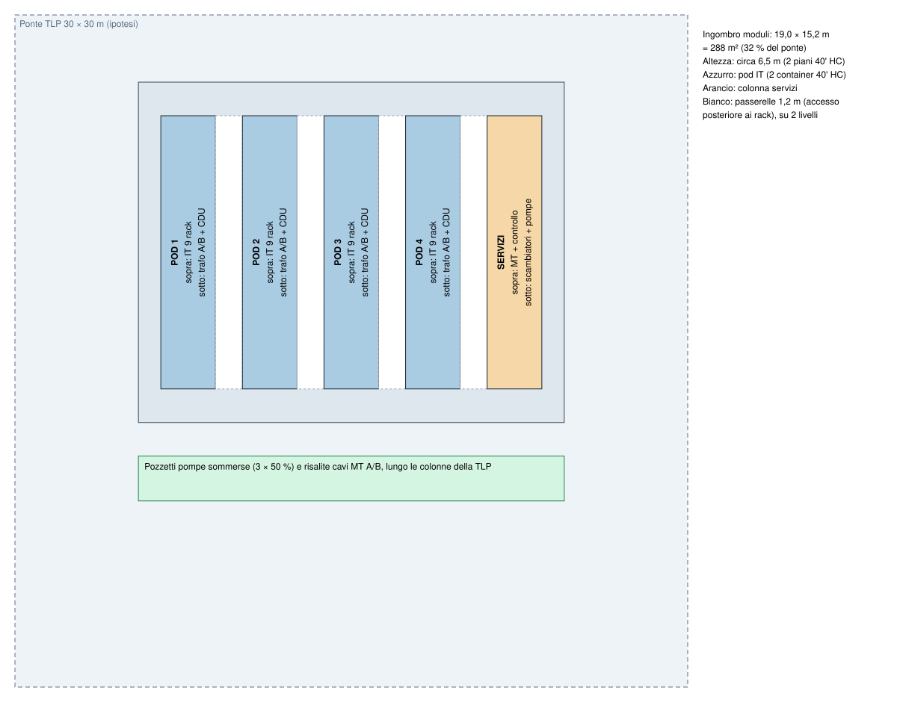
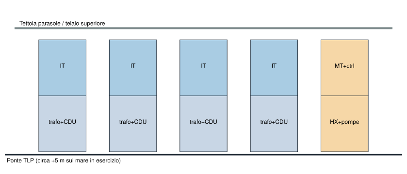

# Layout, masse e baricentro (configurazione A, 2 piani)

- Revisione: A (2026-10-09).
- Numeri: [`calcs/risultati.md`](../calcs/risultati.md) §5 e §6. Disegni generati dallo script: [pianta](layout-pianta-config-a.svg), [sezione](layout-sezione-config-a.svg).
- Coordinate: x lungo il container (0 = testata con la porta ISO), z lungo la larghezza, y in altezza.

## 1. Disposizione sul ponte

- **5 colonne** di 2 container ISO 40' High Cube (12 192 × 2438 × 2896 mm), affiancate sul lato lungo.
- **Passerelle da 1,2 m** tra le colonne, su 2 livelli (ponte e circa +3,05 m): servono all'accesso posteriore ai rack e a far passare tubi e cavi.
- **1,5 m alle testate**: porte ISO, scale, arrivo dei tubi FWS e dei cavi MT.
- Ingombro dei moduli **circa 15,2 × 19,0 m = 288 m²**, un terzo del ponte da 30 × 30 m. Altezza circa 6,5 m con telaio e tettoia parasole.
- Il resto del ponte resta libero per: gru o punto di sollevamento, zona di sbarco del personale, deposito ricambi, eventuale 5° pod o ampliamento della colonna servizi.

## 2. Contenuto dei container

### Pod, container inferiore (potenza + CDU)

| x (mm) | Contenuto |
|---|---|
| 0–800 | Accesso dalla porta ISO, quadro servizi del pod |
| 800–2400 | Quadro generale BT A (2500 A) |
| 2400–4400 | Trasformatore A 1600 kVA a secco in involucro IP31 (circa 2,0 × 1,3 × 2,2 m, n.v.) |
| 4400–6400 | Trasformatore B 1600 kVA |
| 6400–8000 | Quadro generale BT B |
| 8000–8100 | **Tramezzo**: separa la zona elettrica dalla zona liquidi |
| 8100–11 000 | 2 CDU (circa 0,8–1,2 × 1,2 m ciascuna), vasca di contenimento, unità aria/acqua |
| 11 000–12 030 | Arrivo FWS dalla testata, valvole, misura di portata |

Le risalite delle blindosbarre verso il container IT sono sopra i quadri BT; le risalite del circuito TCS sono **solo sopra la zona CDU**, mai sopra trasformatori e quadri.

### Pod, container superiore (IT)

| x (mm) | Contenuto |
|---|---|
| 0–1500 | Bussola d'ingresso (sovrappressione, deumidificatore, filtri chimici), quadretto rivelazione e spegnimento |
| 1500–2700 | 2 rack rete / storage / gestione (circa 10–20 kW, entro il margine) |
| 2700–8100 | **9 rack da 140 kW** (600 × 1068–1200 mm, altezza 2236–2258 mm) con porta posteriore raffreddata |
| 8100–12 030 | Spazio libero: fino a 3 rack in più (variante A+, sotto), oppure ricambi e attrezzature |

- Fila unica di rack; corridoio frontale interno di circa 0,9–1,0 m (larghezza interna 2350 mm − rack 1200 − RDHx circa 250).
- Accesso posteriore ai rack (power shelf, raccordi rapidi) da **porte laterali stagne** sulla parete verso la passerella, una ogni 2 rack, aperte solo con il bel tempo durante la manutenzione.
- Altezza interna 2690 mm: sopra il rack restano circa 430 mm per le 2 blindosbarre (A sul lato frontale, B sul lato posteriore) e per la rivelazione. Stretto: va verificato col disegno.
- Collettori TCS in un canale stagno a pavimento lungo la fila, con vasca e cavo di rilevazione perdite; scendono al container inferiore solo sopra la zona CDU.

### Colonna servizi

- **Sotto (zona bagnata)**: 3 scambiatori in titanio, 3 pompe FWS, 2 filtri autopulenti, antivegetativo, vaso di espansione, trattamento acqua, collettori verso i pod. Pavimento a vasca con drenaggio.
- **Sopra**: quadro MT a 2 semisbarre, 2 trasformatori ausiliari da 250 kVA, 2 UPS ausiliari da 300 kW con armadi Li-ion (in un locale separato con spegnimento dedicato), BMS / DCIM, apparati di rete e terminazione della fibra.
- **Chiller di rifinitura** (2 × circa 700 kW): non entrano nel container servizi con il resto. Posizione proposta: sul ponte libero, in un 20' o skid chiuso accanto alla colonna servizi (circa 6 × 2,4 m), oppure un 6° container sopra lo skid. Da definire col fornitore.

## 3. Masse

| Elemento | Quantità | Massa unitaria (t) | Totale (t) | Nota |
|---|---|---|---|---|
| Container IT allestito | 4 | 24,4 | 97,6 | Tara 40' HC offshore 6,0 + 9 rack × 1,55 + RDHx, blindosbarre, TCS, telaio interno. Limite ISO 30,48 t |
| Container inferiore (potenza + CDU) | 4 | 20,6 | 82,4 | 2 trasformatori × 3,6 + 2 quadri × 1,5 + 2 CDU × 1,3 + varie |
| Skid scambiatori e pompe | 1 | 22,3 | 22,3 | Con l'acqua |
| Container MT e controllo | 1 | 16,7 | 16,7 | |
| Telaio con guide cellulari, passerelle, scale, tettoia | 1 | 28,5 | 28,5 | Stima: da calcolare |
| Tubazioni e passerelle cavi esterne | – | – | 12,5 | |
| Pompe sommerse e tubi di presa/scarico | – | – | 8,0 | Sotto il ponte |
| **Totale** | | | **circa 268 t** | Più i chiller di rifinitura (circa 8–10 t) |

Tutte le masse unitarie sono ipotesi (vedi lo script). La massa dei rack è il dato che pesa di più: 36 × 1,55 = 56 t.

## 4. Baricentro

- Altezza del baricentro sopra il ponte: **circa 2,55 m** (masse pesanti nei container inferiori, rack nel superiore con baricentro a circa 1,2 m dal loro pavimento).
- In pianta il baricentro è spostato verso la colonna servizi solo di poco: la colonna servizi pesa circa 39 t contro circa 45 t di ogni pod. Il centro dei moduli va posto sul centro del ponte, oppure compensato con la zavorra della TLP.
- I limiti del pilota (≤ 1,32 m, ≤ 1,0 m in pianta, per 15 t) **non valgono** per questo carico: vanno richiesti al progettista della TLP da 5 MW.

## 5. Rimorchio e fissaggio

Con le accelerazioni del documento della TLP pilota (SIZ0PLT001 rev 0, rollio 20°, Ay 3,36 m/s², Az fino a 11,54 m/s²) e il fattore 1,3:

| Container IT superiore (24,4 t) | Valore |
|---|---|
| Forza laterale | circa 107 kN |
| Momento ribaltante alla base | circa 130 kNm (contro circa 333 kNm stabilizzanti) |
| Forza verticale | circa 366 kN |
| Riferimento: prova di racking trasversale ISO 1496-1 | 150 kN |

Conseguenze:

1. **Niente ribaltamento**, ma la forza laterale è dello stesso ordine della resistenza a racking di un container integro, e il container IT ha porte laterali che indeboliscono la parete.
2. Serve un **telaio esterno con guide cellulari** (come nelle stive delle navi portacontainer) che porti le forze orizzontali dei container superiori direttamente al ponte. I twist-lock tengono il sollevamento verticale, non le forze laterali.
3. Il telaio deve avere la prima frequenza propria **sopra circa 21 Hz**, lontano dalla banda 6,4–17,2 Hz della TLP pilota (da rifare con i dati della nuova TLP): niente supporti elastici.
4. Dentro i container: rack, CDU, trasformatori e quadri ancorati a pavimento **e** in testa; server con fermi meccanici (REQ-MEC-013 del pilota). Da valutare: rack installati in banchina dopo il rimorchio, o rimorchio con i container vuoti di rack e sollevamento in porto.
5. Il sollevamento in mare di container da circa 25 t richiede certificazione offshore (DNV-ST-E271 / EN 12079): **meglio installare in banchina**, con la TLP in porto.

## 6. Variante A+ (12 rack per container IT)

Il container IT ha spazio per 12 rack. Con 12 rack:

| | A (9 rack) | A+ (12 rack) |
|---|---|---|
| Pod | 4 | 3 |
| Container | 10 | 8 |
| Ingombro | 288 m² | circa 233 m² |
| Container IT pieno | 24,4 t | circa 29,4 t (**al limite ISO di 30,48 t**) |
| Trasformatori per pod | 2 × 1600 kVA | 2 × 2000 kVA |

È la configurazione più compatta con la tecnologia di oggi, ma senza margine sulla massa del container. Da riconsiderare quando le masse dei rack saranno confermate.

## 7. Antincendio, accessi, ambiente

- Ogni container è un compartimento con spegnimento automatico a gas (gas inerte IG-541 o FK-5-1-12, scelta da registrare) e rivelazione ad aspirazione. Zona trasformatori separata dalla zona CDU. UPS e Li-ion in locale dedicato. Le BBU nel rack portano litio in ogni rack: da trattare nella valutazione del rischio incendio.
- Vie di fuga: porta a entrambe le testate di ogni container, scala a ciascuna estremità del telaio.
- Verniciatura CX (ISO 12944-9) di container e telaio, viteria inox, guarnizioni marine; grado di protezione certificato almeno IP56 per porte e passaggi; tettoia parasole per ridurre il carico termico e il ristagno di sale.
- Container in leggera sovrappressione con aria trattata (deumidificazione, filtri chimici, obiettivo ISA-71.04 G1); condensa da assumere presente: niente apparecchiature sotto possibili gocciolamenti.
